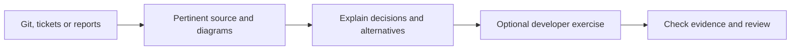

# CoSight

CoSight starts from the premise that human understanding is the bottleneck in AI-assisted software development. An agent can produce a change faster than you can understand how it works. CoSight helps you close that gap. You can ask a question, follow the explanation through the code, and check it against the source.

## Why use CoSight if you already use Claude Code?

You can ask Claude Code to explain a codebase. CoSight can use Claude Code as the agent behind a tour. What CoSight adds is a place to read the answer alongside the source, move between steps, ask a follow-up about a particular passage, and come back to it later.

CoSight is a community project focused on helping people understand software. If you find a better way to explain a change, connect a diagram to the code, or revisit a question, you can contribute it here. The next reader gets that improvement in the same interface.

## Explore a project

Choose a project folder to see its overview and saved tours. Ask a question by typing or using the microphone, then follow the explanation alongside the relevant code and diagrams. A project does not need to be managed with Git.

Select **Previous questions** beside the question field on the project home or in a tour. Search the project’s questions, including follow-ups. **View answer** opens the saved tour at the answer. **Use question** puts the wording in the question field for editing or sending.

You can ask a follow-up directly from a saved tour with a configured CLI agent. The answer stays with the original step. If the question cannot be sent, the text stays in the question field.

Tours and instructions are saved per project. Reusable instruction presets help you repeat a useful kind of exploration across different codebases. Agent settings are shared, so switching projects does not mean setting everything up again.

Open the route from the upper-left toolbar and close it with the × in its header. Full Markdown files appear as formatted pages, scrolled to the passage for the current step.

Narration is optional. Read and navigate while audio prepares in the background. Press Play when you want to listen. Saved narration can be replayed on later visits.

CoSight helps you test your understanding by following explanations back to source. It does not certify that an agent's explanation is correct or replace your application's tests.

## Understand a change

Open **Plugins** from the project home. Install the capabilities you want, then enable them for that project. Installation is shared; enablement is per project. Plugins can be disabled, removed or reloaded without restarting CoSight. Saved tours and exercises remain available when their plugin is reinstalled.

| Plugin | What it adds |
| --- | --- |
| Git history | A commit graph with branch labels and an explicit base/head comparison. Explain a branch or take a tour of its contribution using source pinned to the selected revisions. Selecting a branch does not check it out or alter your working tree. |
| Linear | An optional, app-owned read connection. Associate a project and attach tickets to the project or selected branch. Explanations can use retrieved ticket intent and discussion, with source links and retrieval times. Git works without Linear. |
| Architecture boundaries | JavaScript/TypeScript import graphs from dependency-cruiser, complete cycle paths and declared forbidden dependencies between folders. Inspect a finding, discuss alternatives or turn it into an exercise. Static imports do not establish runtime behavior or scalability. |
| Diagnostic reports | Read existing ESLint or Ruff JSON reports. Follow the original rule, message and available source coordinates, then ask for an explanation. Reading a report does not run the linter or establish when its source was analyzed. |
| Developer exercises | Create a bounded investigation or edit, manually or from a finding. Keep the objective, criteria, source references, notes and optional issue link together. Explicitly run an existing check and cancel it when needed. Reading progress, check results and reviewer acceptance are separate. |



Evidence carries source and report fingerprints. Changed inputs invalidate it rather than silently presenting old findings as current. Exercise checks can execute project code; choose a check only for a project you trust. A passing check establishes its own result, not that the whole exercise is accepted.

Local plugins can also be installed from the library with a versioned manifest and an absolute ESM entry path. Entries must be self-contained; relative imports are currently unsupported. They execute trusted code in owned subprocesses. That process boundary supports cancellation; it is not a filesystem or network sandbox. The installation form describes the current module contract.

## Read a handover

Use **Open document** to choose an existing Markdown file, including a handover outside the project folder. CoSight reads it where it lives and saves its selection, rather than importing a copy. Refresh rereads the source; a stale preview must be refreshed before starting a reading.

A guided reading uses section diagrams and pertinent code. When a section has no relevant code, the code pane closes and the diagram fills the workspace. It returns when source becomes relevant. Checkpoint, branch and merge references are inspected as evidence; commands in a document are not executed.

## Install

Download the macOS disk image for [Apple Silicon](https://github.com/biosphere-labs/cosight/releases/latest/download/CoSight-mac-arm64.dmg) or [Intel](https://github.com/biosphere-labs/cosight/releases/latest/download/CoSight-mac-x64.dmg). Open the DMG and drag CoSight to Applications. These early builds are unsigned and have not been notarized by Apple.

Contributions are welcome. [Open a GitHub issue](https://github.com/biosphere-labs/cosight/issues) with the question you were trying to answer and what would have helped. When adding a feature, document how to find it and record how you tested it. For desktop changes, rebuild, reinstall and try the feature in the installed app.

## Connect an agent

Open **Agents & settings** to select a locally installed Codex CLI, Claude CLI, Antigravity CLI or custom agent. Built-in providers use the CLI's existing subscription login. Sign-in actions open the provider CLI in Terminal on macOS. CoSight does not require you to enter a provider API key.

Settings separate the agent used across projects from instructions for the current project. Executable detection does not prove that an agent is signed in. Connection and permission steps apply to the selected agent; command/model overrides and external-agent configuration live under Advanced. Supporting code-navigation tools are managed internally. Their default runtime requires [uv](https://docs.astral.sh/uv/).

Use **Built-in guidance** to view or edit the shared instruction text in a small popup. Changes apply to future runs across projects; **Restore default** returns to the shipped text. Project additions and applied presets extend that shared guidance. The effective instructions remain inspectable.

Starter presets are available automatically: **Application overview**, **Trace a request**, **Architecture and tradeoffs**, **Review a change**, **Read a handover**, and **Tests and confidence**. Choosing one fills the project additions; it does not replace the shared guidance. Your saved presets are retained. Applying a preset to one project does not change another project's instructions.

Project code is passed to the agent you choose. Narration and microphone transcription use local browser models after their initial download. Tours, source snapshots and settings are stored locally in `~/.local/share/cosight` by default. Set `COSIGHT_DATA_DIR` to use another location.

Experimental analysis integrations are disabled by default. They are not required for the project overview or tour workflow.

The development checks exercise real Git, dependency analysis, report formats and subprocess behavior. Generated-tour integration tests use a deterministic agent fixture. They do not establish live model explanation quality, a live Linear account grant or acceptance on every desktop platform.

## Develop

Use Node.js 24 or newer:

```sh
npm ci
npm start
```

Run checks with `npm test`, `npm run test:pure` and `npm run check`. The optional Claude Code plugin uses host-generated types. After loading it in Claude Code, run `npx tsc -p .claude-plugin/types/tsconfig.json` to check the host integration. On a Mac, build a disk image for its processor with `npm run dist`.

For headless web development, `Dockerfile.dev` and `scripts/worker-dev.sh` provide an isolated container with Chromium. Use a clean checkout without host `node_modules`, then run:

```sh
mkdir -p ../projects
scripts/worker-dev.sh build
scripts/worker-dev.sh up
scripts/worker-dev.sh test
```

The helper mounts the checkout at `/workspace`, the sibling `projects/` directory read-only at `/projects`, and a named data volume. The web port binds to loopback at `http://127.0.0.1:18099`. Tests run inside the container. Native packaging remains a separate step.

On macOS, `npm run install:desktop` rebuilds and replaces the copy in your user's Applications folder. It preserves application data and stores rollback bundles outside the launcher. Quit the running app and reopen it after installation.
