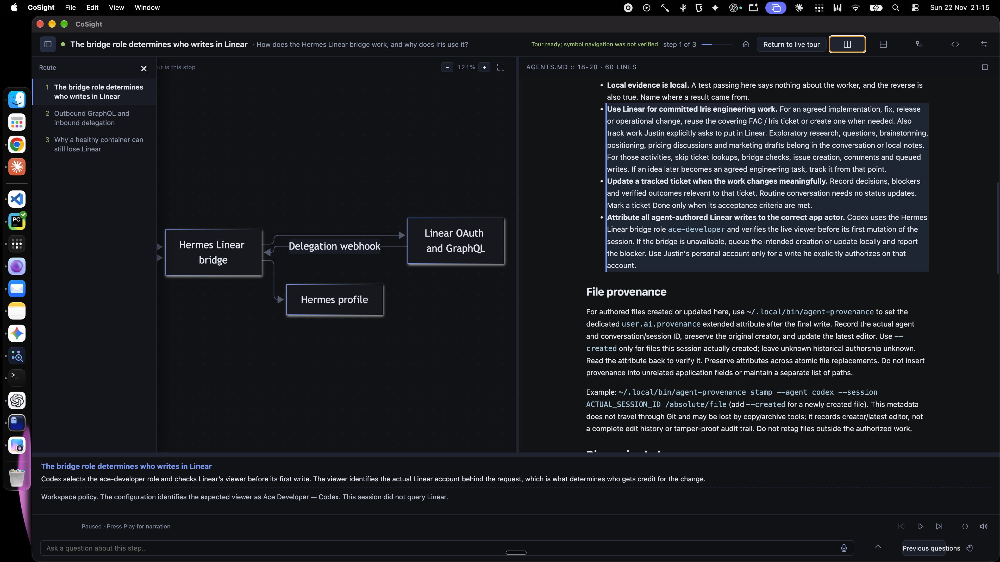

# CoSight

An agent can write a change faster than you can understand it. CoSight gives you a guided tour of the code. Ask a question, follow the explanation alongside the source, then turn the parts worth keeping into Markdown documentation.

## Take a code tour

Open a project folder and ask a question, such as “What happens between receiving a request and saving it?” Each stop in the tour pairs an explanation with the relevant code or diagram. Ask a follow-up at the line that puzzles you. The answer stays with that stop.



You can read at your own pace or press **Play** for narration. **Previous questions** takes you back to a saved answer. If someone has already written a handover, choose **Open document** to follow the Markdown alongside the code it describes.

## Turn a tour into documentation

Switch from **Review** to **Export**. Select the stops and follow-up answers you want to keep, then drag them into reading order. Choose **Export…** to preview the document, give it a title, and select **Download .md** or **Copy**.

The Markdown includes the selected explanations, questions and answers, diagrams, and highlighted code excerpts with file names and line numbers. You can take a question you worked through for yourself and give the next developer a handover they can read outside CoSight.

## Install and connect an agent

Download CoSight for [Apple Silicon](https://github.com/biosphere-labs/cosight/releases/latest/download/CoSight-mac-arm64.dmg) or [Intel](https://github.com/biosphere-labs/cosight/releases/latest/download/CoSight-mac-x64.dmg), open the disk image and drag the app to Applications. These early macOS builds are unsigned and have not been notarized.

In **Agents & settings**, choose your locally installed Codex, Claude, Antigravity or custom CLI. Built-in providers use the CLI’s existing login. Project code goes to the agent you select. Tours, source snapshots and settings are stored locally under `~/.local/share/cosight` by default. Set `COSIGHT_DATA_DIR` to change that location. Supporting code-navigation tools use [uv](https://docs.astral.sh/uv/).

## Plugins are a work in progress

The core tour and Markdown export work independently of plugins. Under **Plugins** on the project home, you can try Git history, Linear ticket context, architecture checks, diagnostic reports and developer exercises. These integrations are experimental, and coverage varies by plugin and environment.

Enable plugins per project. Install local plugins only from sources you trust, and run exercise checks only in trusted projects. If an integration fails, [open an issue](https://github.com/biosphere-labs/cosight/issues) with the plugin name, what you tried and what happened.

## Develop

Use Node.js 24 or newer:

```sh
npm ci
npm start
```

Run checks with `npm test`, `npm run test:pure` and `npm run check`. The optional Claude Code plugin uses host-generated types. After loading it in Claude Code, run `npx tsc -p .claude-plugin/types/tsconfig.json` to check the host integration. On a Mac, build a disk image for its processor with `npm run dist`.

For headless web development, `Dockerfile.dev` and `scripts/worker-dev.sh` provide an isolated container with Chromium. Use a clean checkout without host `node_modules`, then run:

```sh
mkdir -p ../projects
scripts/worker-dev.sh build
scripts/worker-dev.sh up
scripts/worker-dev.sh test
```

The helper mounts the checkout at `/workspace`, the sibling `projects/` directory read-only at `/projects`, and a named data volume. The web port binds to loopback at `http://127.0.0.1:18099`. Tests run inside the container. Native packaging remains a separate step.

On macOS, `npm run install:desktop` rebuilds and replaces the copy in your user's Applications folder. It preserves application data and stores rollback bundles outside the launcher. Quit the running app and reopen it after installation.
